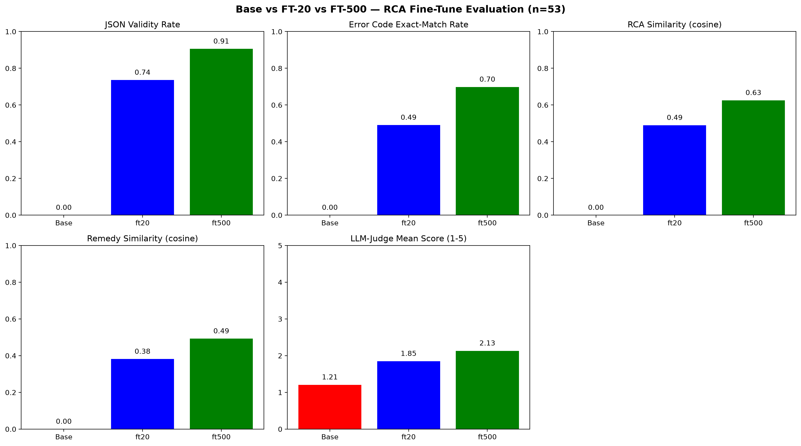

# RCA LoRA Scaling Study: Does More Fine-Tuning Data Actually Help?

A controlled ablation fine-tuning Mistral-7B to extract structured root-cause
analyses from production crash logs — and a from-scratch, 3-tier evaluation
harness built to answer one specific question: **Does scaling a QLoRA
fine-tune's training set 20 → 474 examples measurably improve output quality?**

The short answer is no — and the evidence for that, including where the
gap actually comes from, is below.

---

## Performance Benchmarks

| | Base (Mistral-7B-v0.1) | FT-20 (20 examples) | FT-500 (474 examples) |
|---|---|---|---|
| JSON Validity Rate | 0.00 | **0.81** | 0.79 |
| `error_code` Exact-Match | 0.00 | 0.49 | 0.49 |
| RCA Similarity (cosine, MiniLM) | 0.00 | **0.57** | 0.56 |
| Remediation Similarity (cosine, MiniLM) | 0.00 | 0.46 | 0.46 |
| LLM-Judge Mean Score (1–5, calibrated) | 1.15 | **2.21** | 2.00 |

*n = 53 held-out examples for evaluaiton per checkpoint.*

- **Fine-tuning works, decisively.** Every metric goes from ~0 to meaningfully
  positive the moment LoRA is applied — the base model essentially cannot
  follow the output contract at all.
- **Scaling the training set 20 → 474 examples did not help, and on the metric
  best equipped to catch it, FT-500 is measurably worse.** This is the
  interesting result. Root-caused below — not "the data was bad" (the 474
  new rows were collected with *stricter* filtering than the original 20),
  but a likely LoRA capacity ceiling (`r=8`, `target_modules=["q_proj",
  "v_proj"]` only, held fixed across both runs to isolate the data-volume
  variable).

---

## Architecture

```
GitHub Issues/PRs (public repos)
        │  generate_dataset.py — search, filter, dedup
        ▼
Data_Collection/  ──►  Data/train_dataset_full.jsonl, eval_dataset_full.jsonl
        │
        ▼
Model_Training/train_ft20.py, train_ft500.py  (QLoRA, identical config except data volume)
        │
        ▼
Checkpoints/rca_mistral_adapter_ft20/, rca_mistral_adapter_ft500/
        │
        ▼
Model_Evaluation/output_generation.py  (vLLM, multi-LoRA serving, batched generation)
        │
        ▼
logs/{base,ft20,ft500}_model_outputs.jsonl
        │
        ├─► validity_evaluation.py     ──► Tier 1: JSON validity + error_code match
        ├─► similarity_evaluation.py   ──► Tier 2: embedding cosine similarity
        └─► LLM_judge_evaluation.py    ──► Tier 3: calibrated LLM-as-judge (Gemini 3.8 Flash)
                │
                ▼
        performance_comparision.py  ──►  plots/tier_comparison_chart.png
```



---

## The Task

Given a crash log (user bug report + traceback), extract a structured
root-cause analysis as strict JSON with exactly five keys: `severity`,
`failing_service`, `error_code`, `root_cause_analysis`,
`recommended_remediation`. No markdown fences, no leading or trailing text —
the raw model output must pass `json.loads()` on its own.

## Dataset

Synthetically generated from **public GitHub issue and PR threads** across
82 open-source Python repositories (LiteLLM, LangChain, LangGraph, LlamaIndex,
RAGAS, Prefect, Poetry, Gradio, Keras, Transformers, Dask, Celery, Strawberry
GraphQL, attrs, and many others) using `Gemini 3.8 Flash` to synthesize a realistic
`(input_log, ground_truth_JSON)` pair from each real, human-reported bug. No
proprietary code or private data involved.

Pipeline yield, from the authoritative processed-issue ledger
(`Data/pipeline_state.json`):

| | Count |
|---|---|
| Candidate issues/PRs evaluated | 1,549 |
| Rejected — no traceback in report | 637 |
| Rejected — insufficient context | 330 |
| Rejected — was a PR, not a bug report | 63 |
| Rejected — near-duplicate (embedding similarity) | 18 |
| **Accepted from pipeline** | **501** (→ 454 train / 47 eval) |
| Plus: original seed set (earlier pass of the same pipeline) | 27 (→ 20 train / 7 eval) |

**FT-20 training set:** the original 20 seed examples — collected through an earlier iteration of the same pipeline.
**FT-500 training set:** those same 20 + the 454 new pipeline-collected
examples = 474 total, deduplicated against the seed set by construction.
**Eval set (both checkpoints, and Base):** the 7 held-out seed examples +
47 new held-out examples = 54, minus one outlier excluded for length
(5,071 tokens vs. a 2,286-token next-longest — logged in
`Data_Collection/logs/`) = **53 examples used throughout.**

## Training

Both checkpoints hold every variable fixed except training data volume,
specifically to isolate that one variable:

| | FT-20 | FT-500 |
|---|---|---|
| Base model | `mistralai/Mistral-7B-v0.1` | same |
| Quantization | bitsandbytes 4-bit NF4, double quant, bf16 compute | same |
| LoRA config | `r=8, alpha=32, dropout=0.05, target_modules=[q_proj, v_proj], bias=none` | same |
| Prompt format | `<s>[INST] {system}\n\n{user} [/INST] {assistant}</s>`, loss over full sequence | same |
| Optimizer | `paged_adamw_32bit`, lr `2e-4` | same |
| Training volume | `max_steps=100` (20 examples) | `num_train_epochs=3` ≈ 356 steps (474 examples) |
| Train/eval split | 20 / 7 (seed set) | 474 / 54 (pipeline + seed) |

Step count necessarily differs — 100 fixed steps doesn't map sensibly onto
474 rows — which is the one honest caveat on how "clean" this ablation is;
see [Limitations](#limitations).

**Environment:** trained and served on an RTX 5060 Laptop GPU (8GB VRAM,
Blackwell/SM 12.0) under WSL2 Ubuntu, CUDA 13.0. Generation served through
vLLM 0.29.0 with multi-LoRA (`enable_lora=True, max_lora_rank=8`) loading
Base/FT-20/FT-500 from a single model instance via `LoRARequest`, rather than
three separate model loads.

## Evaluation Methodology

Three independent, from-scratch scoring tiers — deliberately not just one: Tier 1 and Tier 2 score FT-20 and FT-500 as a near-exact tie, and Tier 3 is the only one that catches FT-500 fabricating the root-cause and remedy that don't exist. A single metric would have reported "no difference" and missed the real one.

### Tier 1 — Format Correctness (free, deterministic)
Strict `json.loads()` on the raw output string (no preprocessing, no
extraction — the model's whole job is to emit *only* valid JSON), checked
against the exact 5-key schema, plus `error_code` exact-string-match against
ground truth. Denominator fixed at 53 for every checkpoint, so format
failures aren't rewarded with an easier (smaller) sample.

### Tier 2 — Semantic Similarity (cheap)
Cosine similarity (`all-MiniLM-L6-v2`) between predicted and ground-truth
`root_cause_analysis` and `recommended_remediation`, scored separately.
Rows that fail Tier 1 score 0.0 here too — same fixed-denominator principle.

### Tier 3 — LLM-as-Judge (calibrated)
`gemini-3.8-flash`, 1–5 rubric scoring root cause + remediation jointly
against the input traceback and ground truth. Built and iterated with real
calibration, not taken on faith:

1. Hand-scored a pilot set against the rubric myself.
2. Found the judge systematically flooring correct-but-imprecise answers to
   "hallucination" when the surrounding prose was vague, even when the
   prediction named the exact right function from the traceback.
3. Added an explicit rule distinguishing *"identifier genuinely appears in
   the traceback"* (real credit) from *"restates the user's own bug
   description"* (no credit) — caught and fixed one round of overcorrection
   from the first attempt at this rule before it was right.
4. Re-verified post-fix scores against 9 examples by hand-reading raw
   generated output against ground truth, not just trusting the judge's
   stated reasoning.

## Results, In Detail

**Base is overwhelmingly worse everywhere** — 0.00 across all five metrics.
A non-instruct base model prompted with a JSON-only instruction largely
cannot follow it; failures range from repeating the prompt in a loop to
pure whitespace collapse.

**FT-20 vs. FT-500 is a near-total tie on Tiers 1–2**, and a real,
verified gap on Tier 3 (2.21 vs. 2.00). Manually cross-checked 9 of the 11
examples driving that gap against raw ground truth — 8 of 9 confirm FT-500
producing **genuinely fabricated technical content**, not just vaguer
prose. Each is independently checkable against `logs/ft500_model_outputs`.jsonl at the listed `example_index`:

- \#13 — proposes fixing a `FileExistsError` with `os.rename(check=True)`; Python's `os.rename()` has no `check` parameter.
- \#18 — invents a PyTorch class (`QueryLayer`) and kwarg (`dtypes_only=True`) that exist nowhere in `torch.nn` or `transformers`.
- \#27 — invents a nonexistent library, `DeployablePyTorch`, as the root cause.
- \#40 — contradicts the input it was given: claims a "keyword-only argument" error when the supplied traceback explicitly says "missing 2 required positional arguments."
- \#49 — invents Gradio decorator syntax (`[v] textbox -> Textbox()`) with no basis in Gradio's actual API.

The 9th check (example 32) is the one case FT-500 genuinely outperforms
FT-20 — it correctly names the actual failing method
(`get_partial_shape()`) where FT-20 misses it entirely. Included because
it's real evidence the judge isn't mechanically biased toward one
checkpoint; it rewards whichever answer is actually better.

## Repository Structure

```
rca-lora-scaling-study/
├── README.md
├── .env.example
├── Data/                      # train/eval JSONL splits, pipeline ledger
├── Data_Collection/           # GitHub scraping, dedup, dataset assembly
├── Model_Training/             # QLoRA training scripts (FT-20, FT-500)
├── Checkpoints/                # LoRA adapter weights (~14MB each)
│   ├── rca_mistral_adapter_ft20/
│   └── rca_mistral_adapter_ft500/
├── Model_Evaluation/           # generation + all 3 scoring tiers + chart
├── logs/                 # raw model outputs, Tier 3 judge scores
├── plots/                      # tier_comparison_chart.png
└── requirements.txt          # required modules           
```

## Setup & Reproduction

```bash
pip install -r requirements.txt   # vllm, bitsandbytes, peft, transformers,
                                   # sentence-transformers, google-genai, python-dotenv
```

Create a `.env` file in the repo root:
```
GEMINI_API_KEY=<your-gemini-key>
GEMINI_MODEL=gemini-3.8-flash
GitHub_PAT=<your-github-personal-access-token>   # data collection only
```

Run from the repo root (all internal paths are relative to it):
```bash
python Data_Collection/generate_dataset.py        # rebuild the dataset (optional — already included)
python Model_Training/train_ft20.py
python Model_Training/train_ft500.py
python Model_Evaluation/output_generation.py       # generation across all 3 checkpoints
python Model_Evaluation/LLM_judge_evaluation.py    # Tier 3 scoring
python Model_Evaluation/performance_comparision.py # produces plots/tier_comparison_chart.png
```

## Limitations

- **n=53 eval set.** Enough to be confident in the direction of the Tier 3
  gap (manually verified 9 of 11 driving examples), not enough for tight
  statistical claims.
- **Not a perfectly single-variable ablation.** Step count necessarily
  differed alongside data volume (100 fixed steps vs. 3 epochs on a 20-row
  vs. 474-row dataset) — see [Training](#training).
- **LoRA rank and target modules were deliberately held fixed** (`r=8`,
  `q_proj`/`v_proj` only) to isolate the data-volume question — meaning
  this result says "more data didn't help *at this adapter capacity*," not
  "more data can never help." Widening `target_modules` or raising rank is
  the natural next experiment.
- **Judge calibration was built primarily on FT-20 examples**, then
  explicitly validated against FT-500 examples afterward (see Tier 3
  methodology) — done to catch exactly this kind of one-sided bias risk.
- Single quantization/serving configuration tested (bitsandbytes 4-bit NF4)
  throughout.

## License & Data Provenance

Code: MIT (see `LICENSE`). Training/eval data is synthetically generated
from public GitHub issue and PR threads via the Gemini API — no private
repositories or proprietary code were accessed.

---
